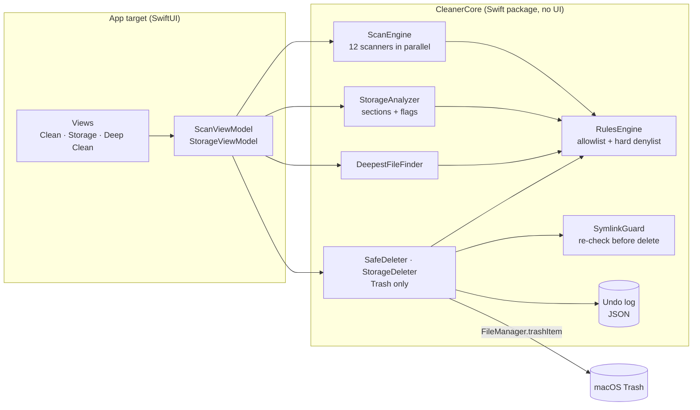
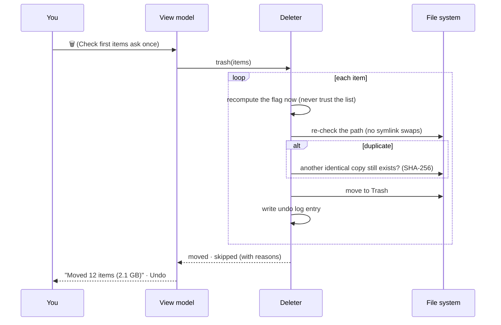

<div align="center">

# Mac Sweeper

**Free up space on your Mac, and see exactly what you're deleting.**

A native, open-source Mac cleaner built with Swift and SwiftUI. It finds caches, logs,
duplicates and leftovers,<br>
shows every file with a clear flag, and moves only what you choose to the Trash. Undo included. No subscription.

[](https://github.com/thejunghare/mac-sweeper/actions/workflows/ci.yml)
[](LICENSE)


[](https://github.com/thejunghare/mac-sweeper/stargazers)
[](https://www.buymeacoffee.com/thejunghare)

</div>

```
┌─ Clean ────────────┬──────────────────────────────────────────────────────────────┐
│ ✦ Clean            │  User Caches                                  8.3 MB    ✓    │
│ ▤ Storage          │  ● com.spotify.client     ~/Library/Caches     4.1 MB   ✔    │
│ ↓ Deep Clean       │  ● com.apple.Safari       ~/Library/Caches     2.0 MB   ✔    │
│                    │                                                              │
│                    │  Duplicate Files                             1.22 GB    ✓    │
│                    │  ● IMG_2041 copy.heic     ~/Downloads          3.2 MB   !    │
│                    │  🔒 IMG_2041.heic          ~/Pictures           3.2 MB   !    │
│                    │                                                              │
│                    │  Large Files                                131.47 GB   ✓    │
│                    │  ○ old-backup.dmg         ~/Downloads          48 GB    !    │
│ 🛡 Privacy         ├──────────────────────────────────────────────────────────────┤
│                    │  3 selected · 6.1 MB                          [ Clean… ]     │
└────────────────────┴──────────────────────────────────────────────────────────────┘
   ✔ safe to delete   ! check first   ⊖ can't delete   🔒 the copy that's always kept
```

---

## Why I built this

Every Mac eventually shows the same warning: *your disk is almost full*. Then you open **System Settings → Storage** and see a huge grey bar called **System Data**, with no way to look inside it.

The apps that clean this up well are paid, closed and often pushy, with "Your Mac is at risk!" pop-ups and subscriptions. And when an app's whole job is deleting files, *trust* is the feature. I didn't want a magic "Clean" button. I wanted to see **every file**, know **why** it's safe (or not), and be able to **undo**.

So Mac Sweeper is free and open source. It shows exactly what it found, flags each item with one icon, and only ever moves files to the Trash, never straight into oblivion.

It's also a real-world teaching project: Swift concurrency, SwiftUI, file-system safety and threat modelling, all in one app you can read end to end.

## Features

| | |
|---|---|
| **Clean** | Scans 12 kinds of reclaimable files in parallel: app and browser caches, logs, Xcode junk, the Homebrew cache, Mail downloads, iPhone backups, leftovers of uninstalled apps, large files and duplicates. |
| **Storage** | The sections from *System Settings → Storage* (Applications, Developer, Documents, Mail, Photos, Trash, System Data), but you can open each one and act on the files inside. |
| **Deep Clean** | Finds the most deeply nested file in your home folder, like `find ~ -type f` in Terminal, and lists the files that are safe to remove, largest first. |
| **One flag per file** | ✔ **Safe** (rebuilt automatically) · **!** **Check first** (your files and apps) · ⊖ **Can't delete** (part of macOS, or managed by its app). Hover for the reason. |
| **Delete = Move to Trash** | Nothing is erased. Everything goes to the Trash, and **Undo** puts it back. The Trash is never emptied for you. |
| **Duplicates, safely** | SHA-256 matching. One click selects the extra copies; **one copy of every file is always kept**, and re-checked just before deleting. |
| **Safety first** | A hard denylist (`/System`, `/usr`, `/bin`, …), symlink and race-condition checks right before every delete, and type `DELETE` to confirm iPhone backups. |
| **Private by design** | No network, no analytics, no accounts. Only names, sizes and dates are read; file contents are read only to compare duplicates, and that stays on your Mac. |
| **Native** | SwiftUI with Liquid Glass on macOS 26+, system materials on older versions; light and dark mode; VoiceOver labels and keyboard shortcuts. |

## Quick start

**Requirements:** macOS 13 or later to run. To build: **Xcode 26 or later** and [Homebrew](https://brew.sh).

```bash
brew install xcodegen
git clone https://github.com/thejunghare/mac-sweeper.git ~/mac-sweeper
cd ~/mac-sweeper
./run.sh            # generates the Xcode project and opens it
```

Press **⌘R** in Xcode. That's it.

**Prefer the Terminal only?**

```bash
xcodegen generate
xcodebuild -project Broom.xcodeproj -scheme Broom -configuration Debug \
  -derivedDataPath build CODE_SIGN_STYLE=Manual CODE_SIGN_IDENTITY=- build
open build/Build/Products/Debug/Broom.app
```

> The app's internal name is still **Broom** (project, scheme and bundle). Renaming it to Mac Sweeper is on the roadmap.

**Full Disk Access.** macOS hides some folders (Mail, Safari, iPhone backups) from every app until you allow it. Mac Sweeper works without it and tells you what it skipped. To include everything: *System Settings → Privacy & Security → Full Disk Access → add the app*, then relaunch it.

**Something not showing up after `git pull`?** Run `./run.sh` again (new files need a fresh Xcode project), then *Product → Clean Build Folder* (⇧⌘K) and ⌘R.

## How the flags are decided

Every item gets exactly one flag, decided on your Mac from its location and permissions, and **decided again right before deleting**, so an out-of-date list can never delete the wrong thing.

| Flag | Means | Examples | Delete button |
|---|---|---|---|
| ✔ **Safe** | Rebuilt automatically when needed | `~/Library/Caches`, logs, Xcode DerivedData, Homebrew downloads | Moves to Trash in one click |
| **!** **Check first** | Your data or an app | Documents, Downloads, large files, duplicates, apps, Mail attachments | Asks once, then moves to Trash |
| ⊖ **Can't delete** | Part of macOS, managed by its app, or already deleted | `/System`, Safari, the Photos library, Mail's database, the Trash itself | Disabled; *Show in Finder* instead |

iPhone and iPad backups are never selected automatically; you type `DELETE` to confirm, because a backup may be your only copy.

## Usage

### Clean
Press **Scan** (⌘R). Results are grouped by category. Junk is pre-selected; iPhone backups and your own files (large files, duplicates) never are. Pick what you want, press **Clean…**, confirm, done. **Undo** (⌘Z) on the summary screen puts everything back.

### Storage
Shows your disk usage, then each section with its size. Open a section to see what's inside, largest first. Click the 🗑 next to an item, or **Delete Safe** in the toolbar to clear every safe item in that section. Right-click any row for *Show in Finder*.

> Part of *System Data* is swap files, Time Machine snapshots and macOS's own caches. macOS manages those itself and no app can safely remove them, so the listed total is lower than the number in System Settings. That's expected.

### Deep Clean
Walks your whole home folder and shows the deepest file with its flag, then everything safe to remove. Use the 🗑 next to the heading to remove them all, or one 🗑 at a time.

### Duplicates
Click ✓ next to **Duplicate Files** to select every extra copy. The copy that stays shows a 🔒 and can't be selected. Before each delete, Mac Sweeper checks that another copy still exists and still has the same SHA-256. If you edited one since the scan, both stay.

## Privacy & safety

- **Read:** file names, sizes, dates and permissions. File *contents* only to compare duplicates (hashed locally, never stored or sent).
- **Never sent:** anything. The app makes no network requests and has no analytics.
- **Written:** only by moving items you chose to the Trash, plus an undo log in `~/Library/Application Support/Broom/undo_log.json`.
- **Never touched:** `/System`, `/bin`, `/sbin`, `/usr`, `/Library/Extensions`, `/private/var/db`, SIP-protected files, the folders that hold everything (your home folder, `~/Library`, `~/Documents`, …), the Photos and Mail libraries, other apps' sandboxed data.
- **Never automatic:** no auto-clean, no background scans, no emptying the Trash. No fake "your Mac is at risk" alerts.

See [docs/SECURITY.md](docs/SECURITY.md) and [docs/THREAT_MODEL.md](docs/THREAT_MODEL.md) for the full model and how each rule is tested.

## Architecture



**What happens when you press 🗑:**



All the logic that decides what may be deleted lives in **CleanerCore**, a plain Swift package with no UI. That keeps it unit-testable against fake home folders: the tests never touch your real files.

## Project layout

```
├── App/              SwiftUI app: views, view models, resources
├── Core/             CleanerCore package
│   ├── Scanning/     12 scanners, ScanEngine, DeepestFileFinder
│   ├── Storage/      StorageAnalyzer, StorageDeleter
│   ├── Deletion/     SafeDeleter, UndoLog, UndoRestorer
│   ├── RulesEngine/  allowlist, hard denylist, SymlinkGuard
│   └── Tests/        unit tests on temporary fixture folders
├── AppTests/         app-level tests
├── docs/             SECURITY.md, THREAT_MODEL.md
└── project.yml       xcodegen spec (generates the Xcode project)
```

## Development

```bash
cd Core && swift test                       # fast: core logic only
xcodebuild -project Broom.xcodeproj -scheme Broom test   # everything
swiftlint lint                              # style
```

CI runs the Core tests, SwiftLint and the full app build and tests on every push to `main` and every pull request.

## Roadmap

- [x] Parallel scanners with a rules engine and hard denylist
- [x] Trash-only deletion with Undo
- [x] Full Disk Access guidance
- [x] Storage view like System Settings, with per-file delete
- [x] Deep Clean and deepest-file finder
- [x] Delete duplicates while always keeping one copy
- [ ] Rename the app from Broom to Mac Sweeper everywhere
- [ ] Signed and notarized download (`.dmg`)
- [ ] Homebrew install (`brew install --cask mac-sweeper`)
- [ ] Automatic updates (Sparkle, signed)
- [ ] App icon

Ideas and votes welcome in [Issues](https://github.com/thejunghare/mac-sweeper/issues).

## Contributing

Pull requests are welcome. Because this app deletes files, every change to what can be deleted needs a test in `Core/Tests` and an entry in [docs/SECURITY.md](docs/SECURITY.md). If Mac Sweeper helps you or your students, a ⭐ helps other people find it.

## Support the project

Mac Sweeper is free and always will be. If it saves you some disk space (or a subscription), you can buy me a coffee ☕.

<a href="https://www.buymeacoffee.com/thejunghare"></a>

> Not affiliated with or endorsed by Apple, MacPaw (CleanMyMac), OnyX, DaisyDisk or CCleaner. No warranty: review what you delete.

## License

[MIT](LICENSE) © Prasad Junghare
